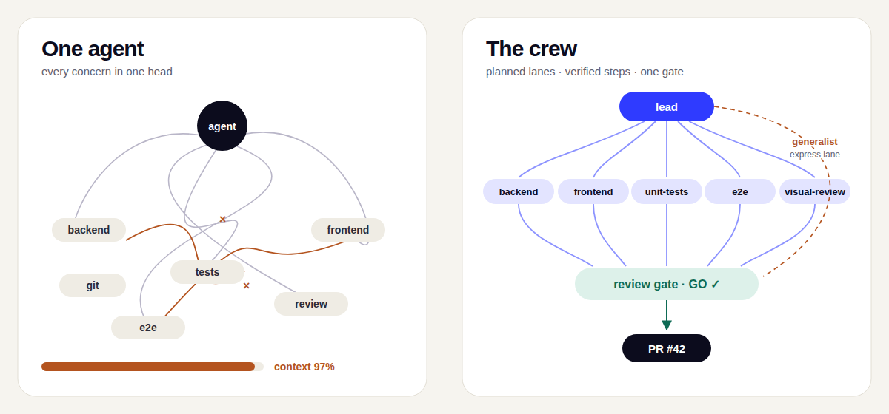

# crew

[](https://github.com/johantor/crew/releases)
[](https://github.com/johantor/crew/actions/workflows/validate.yml)
[](LICENSE)

**Ship Optimizely features like a team, not a single agent.** crew is a
[Claude Code](https://code.claude.com/docs/en/overview) plugin: a `lead` agent plans the work
and delegates each step to specialists that know the CMS they work in, behind hook-enforced
guardrails and one review gate. It also pays down tech debt, one verified fix at a time.

```bash
claude plugin marketplace add johantor/plugins
claude plugin install crew@johantor
```

…or in the UI, from `/plugin > Discover` in Claude Code. crew is part of the
[`johantor`](https://github.com/johantor/plugins) marketplace.

Installed from `johantor/crew` before? That source is gone: run `claude plugin marketplace remove
johantor`, then the two commands above.

<!-- Illustration source: docs/solo-vs-crew.svg (edit the SVG, then re-export the PNG). -->


Site: <https://johantor.github.io/crew/> · Marketplace: <https://johantor.github.io/plugins/>

## Built for Optimizely

One skill per product. The `backend` specialist reads your `EPiServer.CMS` version and loads the
matching skill.

| Skill | Covers | Status |
|---|---|---|
| `optimizely-cms12` | CMS 12 (ASP.NET Core, PaaS/DXP) | Available |
| `optimizely-cms13` | CMS 13 (.NET 10): applications, Graph, Visual Builder | Available |
| `optimizely-cms-upgrade` | The 12 → 13 upgrade | Available |
| `optimizely-graph` | Graph: sync, schemas, keys, querying from .NET and headless front ends | Available |
| `optimizely-cms-saas` | SaaS CMS: content types in code, Visual Builder, live preview | Available |
| `optimizely-search-navigation` | Search & Navigation (Find) on CMS 12, and the move to Graph | Available |
| `optimizely-odp` | Data Platform: events, profiles, real-time audiences for CMS and Experimentation | Available |
| `optimizely-opal` | Opal custom tools: the discovery contract, registries, auth | Available |
| `optimizely-opal-tools-dotnet` / `-node` / `-python` | One skill per Opal tools SDK (C#, TypeScript, Python) | Available |
| `optimizely-commerce-customized` | Customized Commerce: catalog, markets, pricing, orders, promotions, payments | Available |
| `optimizely-commerce-configured` | Configured Commerce: handlers, pipelines, Spire, integration jobs | Available |
| `optimizely-experimentation` | Feature and Web Experimentation: flags, SDKs, the snippet, flicker, cleanup | Available |
| `optimizely-ocp` | Connect Platform apps: functions, jobs, lifecycle, settings, the CLI | Available |

Stacks: .NET, Node, Python (for Opal tools) and shell on the backend; React and Next.js on the
front end.

## Why a crew

- **A plan you approve first.** One gate to catch a misread task before a branch, a commit, or
  worker time is spent.
- **Specialists, not one generalist.** Backend, the client-facing layer, unit tests, e2e, and
  design conformance each go to an agent scoped to that work, with only the tools it needs.
- **Guardrails in code, not prose.** Workers are blocked from `git` outright by `PreToolUse`
  hooks, enforced by the harness rather than by asking politely. File edits are not fenced:
  each plan step names its files, and `lead` checks every changed file before it commits.
- **A gate that can say no, and you hold the door.** `/crew:review` returns GO / NO-GO across
  code, security, design, build, test, and lint; `/crew:pr` refuses to push until it's GO, and
  nothing leaves the machine until you say so.

## What it costs you

- **A crew run is slower than one agent**, and it spends more tokens. Planning, delegation, and a
  consolidated gate are not free. That's what the express lane is for. But if your whole
  workload is one-line fixes, you don't need crew.
- **The checkpoint is a real stop.** `lead` waits for your go-ahead before it branches or
  delegates. Background workers can't prompt, so a step that still needs a decision has to get one
  from you first.
- **`/crew:init` is not optional.** It is the only place the crew learns what the project is.
  `lead` stops a run while a slot it needs is `unset` rather than guess.
- **Nothing ships on its own.** No push, no PR, not even in loop mode. If you wanted
  fire-and-forget, this is the wrong tool.

## Quick start

**A dedicated orchestration session** is the recommended path. The session *is* `lead`:
describe the feature, paste a ticket, ask for a review. It's scoped to crew work, so run
general/config tasks (statusline and the like) in a normal session.

```bash
claude --agent crew:lead
```

**Or from a normal session**, when you want the crew on tap without it taking over:

```
/crew:init                 # once per project: detect and record build/test/lint/format config
/crew:feature <task>       # plan, delegate, build, then stop at the gate
/crew:debt <pointer>       # fix one known debt item in gated, verified batches
```

## Permission mode

**Run the crew in `acceptEdits`** (Shift+Tab), not `auto`. Auto mode **drops `Agent` allow rules
when it starts**, so a worker dispatch is the one thing you can't put on an allowlist: every
delegation is judged individually by the permission classifier, and that classifier is a model.
Two identical dispatches minutes apart can go through and then be refused, mid-run, with the fixed
reason `Blocked by classifier`. Crew is subagent dispatch end to end, so it feels this more than
most plugins. From **14 August 2026** auto mode is the default for new sessions on Pro, Max, and
Team plans — a fresh install lands there unless you switch.

What bounds a run is the crew's own guards — git ownership, the `.git/` guard, refused destructive
commands, and `/crew:pr` as the only user-invoked way anything leaves your machine. Those apply in
every permission mode.

<details>
<summary>Staying in auto mode anyway</summary>

- **`/crew:init` writes a `## Crew orchestration` section** into `CLAUDE.md`. The classifier reads
  `CLAUDE.md`, so this is the lever that ships with the plugin: it describes what a worker dispatch
  is, instead of leaving the classifier a bare label to judge. It is the one thing the command puts
  there by default — the configuration slots live in `.claude/crew.md`. In local mode the section
  goes to `CLAUDE.local.md`, which Claude Code loads alongside `CLAUDE.md`.
- **Describe your project in `autoMode.environment`** in `~/.claude/settings.json`, keeping the
  `"$defaults"` entry. It has to be user-level — the classifier deliberately ignores `autoMode` in
  project `.claude/settings.json`.
- **A denied dispatch retries once.** The `dispatch-denied` hook asks for one retry (the classifier
  still decides), then stops and prints the options above rather than letting `lead` thrash.
- **`/permissions` › Recently denied › `r`** reissues a denied call by hand.

`permissions.allow` is the one thing that won't help — `Agent` entries there are dropped on
entering auto mode.

**Headless and background gates.** Review gates run through `scripts/gate.sh`, one simple command
per call. For a gate worker that cannot prompt (`claude -p`, CI, a background dispatch), allow it
by its installed absolute path, quoted as the recipe quotes it — a `*` inside the path does not
match: `Bash(bash "/abs/path/to/crew/scripts/gate.sh":*)`. Without it, the worker reports the refusal and
stops; it does not improvise another form. **This rule is as wide as allowing all Bash:** `start`
runs whatever command string it is given, so grant it only to a headless run you trust with that.
A gate that passed on the same working tree is answered from `/tmp/crew-gate-cache` instead of
running again; after a toolchain change outside the tree, clear it with `rm -r /tmp/crew-gate-cache`.

</details>

### Plan mode

Plan mode (Shift+Tab, `/plan`, or `claude --permission-mode plan`) works with the crew, and its
approval replaces `lead`'s own plan checkpoint, so you get one gate, not two. What changes
underneath:

- **In a `claude --agent crew:lead` session**, `lead` explores (itself, or through the
  built-in `Explore`/`Plan` research agents, which its agent allowlist includes), presents the
  plan through plan mode's approval prompt, and only then writes `<plan-dir>/plan-<feature>.md`,
  branches, and delegates.
- **From `/crew:feature` in a normal session**, `lead` runs as a subagent, and a subagent
  can neither approve a plan nor write during plan mode. The command launches it twice: once to
  explore and return the plan, which you approve through the normal prompt, and once more with the
  approved plan to build it. The plan travels between the two as text.
- **Editing workers wait.** The `plan-guard` hook refuses a dispatch of any crew worker whose
  tools carry `Edit`/`Write` while the session is in plan mode, before the worker burns its turns
  on edits plan mode would refuse. A read-only worker still runs, so triage before planning works
  as usual. The decision comes from each worker's own definition, not a list kept here.
- **`/crew:loop` and `/crew:address` don't run in plan mode.** Both write on every tick. They say
  so and stop; approve a plan or leave plan mode first.

The catch: a plugin agent cannot declare its own permission mode, so a worker launched from a
plan-mode session is in plan mode whatever its definition says. That is why the guard exists
rather than a per-worker setting.

## Commands

| Command | What it does |
|---|---|
| `/crew:init` | Detect this project's build/test/lint commands, per-edit formatters, base branch, frontend mode, and stacks, and record them in `.claude/crew.md` (committed, so teammates inherit them, or kept local and git-excluded, with the `CLAUDE.md` part in `CLAUDE.local.md`: it asks on the first run). It proposes for `CLAUDE.md` only what a glance at `package.json` would get wrong. Idempotent: re-run to pick up slots a newer version added. |
| `/crew:feature <task>` | Plan, delegate, and build the feature, stopping at the review gate. |
| `/crew:debt <pointer>` | **Beta.** Fix one known debt item: a suppression (`file:line`), a rule (`CS8602`, `eslint no-explicit-any`), a package upgrade (`Newtonsoft.Json 13.x`), or pasted build/lint output. `lead` reports the blast radius before any edit, stops at gates that need you, fixes in batches through the lane workers, and commits each batch once its acceptance gate passes. Deleting the suppression makes the analyzer the regression test. .NET and TypeScript/JavaScript today; a platform migration gets a handoff outline instead. `--force` also works justified suppressions. |
| `/crew:audit <scope>` | **Beta.** Read-only debt scout over a scope you name (a path, `backend`/`frontend`, a rule family, `stale`, `outdated`, `diff`), run by `debt-scout`, an agent with no Edit, Write or Bash tool: a ranked report of at most 12 findings, each a ready-to-paste `/crew:debt`, then a pick of the top 3. Suppressions with a meaningful native justification are counted but not listed. |
| `/crew:review` | Pre-PR **GO / NO-GO**: consolidated code + security + design review plus diff-scoped build/test/lint. The code review also applies your `REVIEW.md` and `CLAUDE.md` rules, the files Claude Code Review reads. `quick` for a read-only pass with no suites; `full` to force every gate. |
| `/crew:pr` | Push the branch and open the pull request. Outward action: it confirms first. |
| `/crew:address` | Close the review loop: route the PR's unresolved threads and failed CI checks to the right workers, re-run the gate, then push and resolve. Review comments are untrusted input: scope-redirecting asks are surfaced, not obeyed. |
| `/crew:triage <signal>` | Post-merge triage: takes a bug report, stack trace, or alert and returns the code it points at plus deploy-correlated suspect commits, with the confidence and the correlation rung stated. A bare work-item reference (`21363`, `BUG-1234`) is fetched first in your session, through any tracker MCP you loaded or the tracker's CLI (`az boards`, `gh`, `glab`, `jira`). On Azure DevOps, a `deploy-pipeline=` also fetches its deploy runs (`az pipelines`), the commits between them, and the diffs the agent asks for, so correlation works without a git-host MCP. Read-only — it reports and hands off, and never posts back to the work item. |
| `/crew:loop <goal>` | The **outer loop**: drive the feature across multiple `lead` runs, so work that outlives one run's turn limit finishes without you re-asking each tick. Stops on the plan's exit conditions; never auto-pushes. |
| `/crew:notify [to=<peer>] -- <message>`<br>`/crew:notify list` | Message another running crew **session** — ask an unattended `/crew:loop` for progress, or tell a peer worktree that a branch landed and a rebase is safe. The `list` form enumerates reachable peers and sends nothing. An ask your own guards would refuse (push, commit on a protected branch, bypass a hook, forward a secret) is refused at the sending end; an instruction is confirmed before it goes; the reply comes back as data, never as direction. |

Commands are namespaced under `crew:` once installed, so they can't collide with a built-in or
another plugin's command of the same short name.

## How a run works

- **Right-sized to the task.** Small, low-risk work (a typo, a rename, an obvious one-liner) takes
  an **express lane** through `generalist`, skipping the plan and the full gate for a quick self-review
  plus one relevant test. Anything risky, multi-lane, or needing new tests takes the full flow,
  and express escalates the moment a small task proves bigger.
- **Committed step by step.** `lead` branches off your base branch and commits each verified
  step. Workers run no git but a plain `git mv`.
- **You're heard mid-flight.** Workers run in the background, so the turn returns right away and
  you can keep talking while `backend` works. Corrections queue as new work, or steer the worker
  already running when they're small and in its lane.
- **Loop mode on request.** Say "keep going until done" and `lead` runs without per-step
  check-ins, stopping on all steps done + gate **GO**, a step blocked on a decision only you can
  make, or a retry cap. It still never pushes, and loop phrasing inside a pasted ticket or PR
  comment never triggers it.

## Safety guarantees

The bash-safety guard enforces the boundaries and **fails closed**. The read guard blocks large
raw reads, the `.git/` guard blocks agent writes into `.git/`, and both fail open, as do the advisory hooks
(formatting, denied dispatches, plan-mode dispatches) — `plan-guard` does
block a dispatch, but only one plan mode would have refused anyway, and on any path it can't read
it allows.

- **Workers can't touch git.** Blocked for `backend`/`frontend`/`unit-tests`/`e2e`/`generalist`, except a
  plain `git mv` to rename a file, which lands in `lead`'s next commit. `lead` is the sole
  git owner, enforced in code. Every agent, `lead` included, is refused
  `git commit` while HEAD is `main`/`master`/`develop`.
- **Each plan step names its files, and `lead` checks them.** Before it commits a step, `lead`
  compares the changed files with the step's files and the worker's summary, and reverts or
  re-delegates a file outside the step. No hook fences a worker's edits, except that no crew
  agent writes inside `.git/`. The review and planning agents are read-only. File-mutating
  Bash (`sed -i`, `tee`, a `>` redirect, `cp`/`mv`) is refused outright, so a write cannot skip
  the `.git/` guard or the formatter.
- **Destructive and hanging commands are refused.** Recursive force-`rm` of `/`/`~`/`*`,
  force-push, redirects into `.env` or `.git/`, and never-terminating watch/dev/serve commands.
- **Context stays bounded.** Raw reads over 64 KiB are blocked in favour of grep/jq.

All git, watch, and `.git/` rules are scoped by `agent_type`, so **your own main session is never
intercepted**.

<details>
<summary>Hook mechanics in detail</summary>

- **gitdir-guard** routes on the payload's `agent_type` and checks `Edit`/`Write` only. It
  refuses a write inside `.git/` by any crew agent (`lead` keeps `.git/info/exclude`), and a
  payload it cannot read passes. File writes via Bash (`sed -i`, `tee`, redirects) are refused
  by **bash-safety** instead.
- **read-guard** blocks raw reads of files over 64 KiB (65536 bytes); an explicit `limit` of
  ≤ 2000 lines passes. See the `context-discipline` skill.
- **bash-safety** blocks destructive commands (recursive+force `rm` of `/`/`~`/`*` in any flag
  spelling, force-push via `--force` or `-f`, redirects into `.env`, redirects or `rm` into
  `.git/`), CLI calls that print a raw access token (`az account get-access-token`,
  `Get-AzAccessToken`, `gh auth token`; use `az rest`, `gh api` or an MCP server, which keep the
  token inside the tool) and raw/streaming reads (`cat`, `less`, `tail -f`). For agent sessions it also refuses
  file-mutating Bash — an in-place `sed`/`perl`/`ruby`/`awk`, `tee`, `patch`, `cp`/`mv`, and any
  redirect whose target is not an exempt sink (`/dev/null`, an fd dup, the temp directories, an
  unquoted absolute path of plain segments outside the project, such as an out-of-tree build
  root) — and
  names `Edit`/`Write` instead. That half is a floor, not a sandbox: a build's own code generator
  still writes files, and a write hidden inside a quoted `bash -c` string is not read as one. What
  it closes is the routine path, the one auto mode's own notice recommends. `visual-review` has no Bash
  tool, so it needs no entry. Whatever your *resolved* base branch is (`develop`, `trunk`, …), `lead` and
  `/crew:pr` keep the crew off it too.
- **format** runs the project's formatters after an edit by `backend`, `frontend`, `unit-tests` or `generalist`,
  from the `formatMatrix` slot `/crew:init` writes: one row per `<dir> <extensions> <command>`,
  every row whose directory and extension match the edited file, in order, from that directory,
  `{file}` substituted. The hook detects nothing; a file no row covers is left alone, and
  `none`/`unset` turns per-edit formatting off. A row whose tool is gone is reported with a
  `/crew:init` nudge that the worker hands back. Single-file formatters only — whole-project
  tools (`dotnet format`, shfmt) stay at the lint gate. Best-effort: fails open.
- **dispatch-denied** runs on `PermissionDenied` for `Agent`/`Task` calls and reacts only to a
  `crew:<worker>` dispatch. The first denial of a worker in a session asks for one retry — the
  retried call goes back through the classifier, which still decides — and every later one
  reports the fixes instead, so a repeatedly-blocked step is handed back rather than retried in a
  loop. It matches on the `crew:` namespace rather than a name roster, so it can't drift as
  agents are added. Advisory: it never retries on a path where it couldn't count the attempts.
- **plan-guard** runs on `PreToolUse` for `Agent`/`Task` calls and acts only when the payload's
  `permission_mode` is `plan` and the target is a `crew:<worker>`. It reads that worker's own
  frontmatter: `owns-git: true` (the orchestrator) passes, and so does any worker whose `tools:`
  carry no `Edit`/`Write`; an editing worker is refused with a message naming plan mode and what
  to do first. No roster, so nothing to keep in lockstep. Fails open: no `jq`, an unreadable
  payload, an agent file it can't find, all allow — plan mode itself still blocks the edits.

Hooks are registered in `hooks/hooks.json`.

</details>

## Optional MCP servers

The plugin bundles none and every agent degrades gracefully without them, so all of these are
optional; crew works out of the box. Add MCP config in your own session (project `.mcp.json` or
`claude mcp add`), not the plugin: the harness strips `mcpServers` from plugin-shipped agent
frontmatter for security.

<details>
<summary>Which servers help, and what you lose without each</summary>

| Purpose | MCP server | Used by | Without it |
| --- | --- | --- | --- |
| Browser automation & visual checks | [Playwright](https://github.com/microsoft/playwright-mcp) or [Chrome DevTools](https://github.com/ChromeDevTools/chrome-devtools-mcp) | `frontend`, `visual-review`, `web-review` | `visual-review` reports a browser MCP is needed — it measures the rendered UI through this, so without one there is nothing to compare; `web-review` reviews the code only; `frontend` skips its browser loop-checks |
| Design reference | [Figma MCP](https://developers.figma.com/docs/figma-mcp-server/) — Dev Mode (local) or the hosted `claude.ai Figma` connector | `frontend`, `visual-review`, `designer` | all fall back to the design reference passed in the delegation |
| Library & framework docs | [Context7](https://github.com/upstash/context7) | `backend`, `frontend` | implementers code from memory instead of current, version-specific API docs |
| Issue tracking (ticket-in) | [Atlassian (Jira/Confluence)](https://www.atlassian.com/platform/remote-mcp-server) or [Linear](https://linear.app/docs/mcp) | `lead` | `lead` plans from the prompt alone; paste ticket details in by hand |
| Git hosting (ticket-in / PR-out) | [GitHub](https://github.com/github/github-mcp-server) or [Azure DevOps](https://github.com/microsoft/azure-devops-mcp) | `lead` | crew stops at the local **GO/NO-GO** gate; open the PR with `/crew:pr` |
| Database (schema & test data) | [SQL Server](https://learn.microsoft.com/en-us/sql/mcp/) or [Postgres](https://github.com/crystaldba/postgres-mcp) | `backend`, `unit-tests` | data-access code and integration tests work from assumed schema |
| Error monitoring | [Sentry](https://mcp.sentry.dev/) | `lead` | bug context (stack, breadcrumbs) must be pasted in by hand |

Playwright and Chrome DevTools are interchangeable for the crew's needs: both evaluate scripts
in the page (how `visual-review` measures computed styles and geometry) and both list console messages
and network requests (how it finds the failed font or asset behind a visual defect). Chrome
DevTools is Chrome-only but adds performance/Lighthouse tracing and CDP-level detail.

**Server keys map to tool namespaces.** When you add a server you choose its *key*, e.g.
`playwright` in `.mcp.json`. Claude Code exposes that server's tools under the matching
`mcp__<key>` namespace, and that namespace is what the agents allowlist. Use these keys so the
allowlist matches out of the box:

- `playwright` / `chrome-devtools` (browser) and `figma` / `figma-desktop` (design):
  `frontend` + `visual-review`
- `context7` (docs): `backend` + `frontend`
- `mssql` / `postgres` (database): `backend` + `unit-tests`
- `github` / `ado` (git host), `linear` / `atlassian` (issue tracking), `sentry` (errors):
  `lead`

`figma-desktop` is the key Figma's own install docs use for the Dev Mode server; `figma` is
allowlisted too, so either works.

If you give a server a different key, grant the matching `mcp__<key>` to the relevant agent(s).

**Connected it on claude.ai instead of adding it here?** A connector's namespace is its display
name, and which form you get depends on the surface: `mcp__claude_ai_<Name>` in the Claude Code
CLI, the bare `mcp__<Name>` on claude.ai's own surfaces. The design, git-host, issue-tracking, and
error connectors are allowlisted in both forms (`claude_ai_Figma` / `Figma`, `claude_ai_GitHub` /
`GitHub`, and so on for Linear, Atlassian, Sentry). A connector under any other display name needs
its `mcp__<Name>` granted to the relevant agent(s).

**Installed the server as a plugin instead?** Then its tools carry the plugin's name too —
`mcp__plugin_<plugin>_<server>__<tool>` — and a bare `mcp__<key>` grant never matches them. Note
the plugin and the server it bundles are keyed independently: the `chrome-devtools-mcp` plugin
ships a server called `chrome-devtools`, so its tools are
`mcp__plugin_chrome-devtools-mcp_chrome-devtools__*`. The agents allowlist one plugin namespace per
server — the packaging we've seen for it, so `chrome-devtools` is covered as
`mcp__plugin_chrome-devtools-mcp_chrome-devtools` and most others as `mcp__plugin_<key>_<key>`;
Playwright carries both, since either packaging is plausible. If yours differs, read the exact
namespace off `/mcp` (the server line reads `plugin:<plugin>:<server>`) and grant that prefix to
the relevant agent(s). This bites quietly: an agent can't tell a server that isn't allowlisted from
one that isn't installed, so it just reports the server as unavailable.

</details>

## What's included

- **Agents:** `lead` (captain) and the workers `backend`, `frontend` (client-facing layer),
  `unit-tests`, `e2e`, `visual-review`, `generalist` (express path), `incident-triage`
  (post-merge, read-only), `debt-scout`, `analyst`, `architect`, `security-review` and
  `web-review` (read-only), `designer` and `copywriter`. Workers stay idle until `lead` or a
  command delegates.
- **Commands:** `/crew:init`, `/crew:feature`, `/crew:debt`, `/crew:audit`, `/crew:review`,
  `/crew:pr`, `/crew:address`, `/crew:triage`, `/crew:loop`, `/crew:notify`.
- **Hooks:** `.git/` guard, read guard, bash safety, formatter entrypoint,
  dispatch-denied advisor (see *Permission mode*).
- **Skills:** always on for every agent: `context-discipline`. For `lead`: `loop-engineering`,
  `operator-voice` and `review-gate` (the gate rules, which `/crew:review` loads too). For the implementers `backend`, `frontend` and `generalist`: `engineering-principles`.
  For the five workers with a shell: `worker-contract` (the rules every dispatch follows). For
  every worker: `mid-run-direction` (how to treat a steer that arrives mid-run), and
  `design-tokens` for the agent doing design conformance.
  Loaded once the stack is resolved: per frontend mode (plus `frontend-razor` for `.cshtml` views), per backend stack (.NET, Node, Python, shell —
  plus one skill per Optimizely product on top, today CMS 12, CMS 13, SaaS CMS, Graph, Search & Navigation, ODP, Opal with a tools skill per SDK, Customized and Configured Commerce, Experimentation, and OCP; any other backend runs best effort as `other`, with the project's own skill), per frontend stack (React, Next.js; any other view runs best effort as `other`), and per test tool
  (xUnit, pytest, bats, Vitest, Jest, Cypress, Playwright).

Local agent memory is git-ignored (`.claude/agent-memory-local/`).

**In a git worktree, only committed files outlive the worktree.** Local memory and plans both
resolve relative to the project directory — memory at `.claude/agent-memory-local/`, plans at the
**Plan directory** slot or `.claude/` when it is unset — so they sit inside the worktree, and
`git worktree remove` deletes those copies. Configuration is never in memory: it lives in
`.claude/crew.md`, which travels with the branch when committed. A local, git-excluded
`.claude/crew.md` is not in a new worktree, so `lead` stops there. Point **Plan directory** at a
tracked path (e.g. `docs/plans/`) so a plan you commit lands on the branch instead of in the
untracked `.claude/` fallback.

## Contributing

Start with [AGENTS.md](AGENTS.md), the contributor guide, and the code map in
[CLAUDE.md](CLAUDE.md). A PR that changes orchestration behavior is
verified against [VERIFICATION.md](VERIFICATION.md). Release notes are in
[CHANGELOG.md](CHANGELOG.md).

## Requirements

- [Claude Code](https://code.claude.com/docs/en/overview) with plugin support (CLI, desktop, or
  IDE extension).
- A git repository: crew branches and commits its work.
- Optional: the MCP servers above, for visual review and PR workflows.

## Updating and uninstalling

```bash
claude plugin marketplace update johantor    # refresh the plugin catalog
claude plugin update crew@johantor           # update the plugin
claude plugin uninstall crew@johantor        # remove it
```

## See also

[board](https://github.com/johantor/board): a local kanban board of every Claude Code session,
crew runs included (`claude plugin install board@johantor`).

## License

[Apache-2.0](LICENSE). The plugin collects no data and sends nothing to the maintainers; see
[PRIVACY.md](PRIVACY.md). An independent project, not affiliated with or endorsed by Optimizely
or Anthropic.
